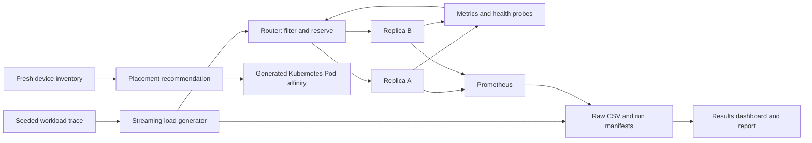

# KubeAI technical report

> Historical emulator-release snapshot dated 27 October 2026. For the current scope/setup and subsequent real-GPU energy experiments, use the [main README](../README.md) and [progress report](PROGRESS.md). Statements about unfinished work or unavailable hardware below describe that earlier snapshot.

Implementation and local evaluation: 27 October 2026. This report distinguishes the supplied earlier hardware observations from newly measured emulator behavior.

## Objective and delivered system

The project asks whether model-compatible, queue/capacity-aware request routing and simple GPU placement can improve inference latency and resource use over simple baselines. The implementation provides an observe → decide → act → measure loop, with an OpenAI-compatible HTTP proxy as the actuation point. It does not train a model.



The router validates model availability at `/v1/models` before admitting a replica. Endpoints must be healthy within the configured TTL, advertise the requested model, allow it in configuration and support the requested output budget. Exact prompt/context validation remains the model server's job because this prototype has no tokenizer.

Selection and local in-flight reservation occur in one lock. A single router process therefore does not direct simultaneous arrivals using the same unreserved snapshot. Endpoint removals affect new selections while existing requests keep their connection. Upstream failures trigger a short circuit cooldown; a later successful model probe does not bypass the cooldown. Requests are not automatically replayed after dispatch, avoiding duplicate generation or stream corruption.

Static endpoint configuration supports hot reload with last-valid retention. In Kubernetes, namespaced EndpointSlice polling discovers individual ready, non-terminating addresses. Discovery failure expires the discovered set after its freshness deadline. This implements replica lifecycle handling without choosing a gateway product.

## Routing policies

All policies use identical health/model eligibility and the same router in-flight cap.

| Policy | Selection rule |
| --- | --- |
| Round-robin | Rotate among eligible replicas |
| Capacity | Minimize `(local_inflight + 1) / configured_capacity` |
| KubeAI | Minimize the transparent score below; rotate equal-score ties |

For an eligible replica:

```text
service = configured_prefill_seconds + requested_output_budget × configured_token_seconds
load = max(local_inflight, observed_waiting + observed_running) / configured_capacity
memory_pressure = clamp(1 - observed_free_memory / observed_total_memory, 0, 1)

score = queue_weight × load × service
      + service_weight × service
      + kv_weight × observed_KV_fraction
      + memory_weight × memory_pressure
```

Lower is better. Default weights are `queue=1`, `service=1`, `kv=0.1`, `memory=0.05`. Queue and service terms are in seconds; KV/memory weights translate dimensionless pressure into configurable score penalties in seconds. They are interpretable initial choices, not fitted coefficients. GPU memory/KV terms can be ablated by setting their weights to zero, then replaying the same trace with otherwise fixed conditions.

Local and observed work overlap, so the policy takes their maximum instead of adding them. A stale or missing metric is omitted and local reservations remain usable if endpoint health is still current. Missing memory is not interpreted as available memory. A separate physical GPU sample expires independently of vLLM telemetry. Every KubeAI selection logs its terms and freshness state without prompts or credentials.

The parser recognizes vLLM's queue/running gauges and KV fraction, including the older `gpu_cache_usage_perc` name. KV usage is a fraction where 1 means full use, following the official [vLLM metric definitions](https://docs.vllm.ai/en/latest/usage/metrics/). Engine-labelled request counts are summed and pressure gauges conservatively aggregated. The optional exporter selects exactly one NVIDIA device; it never attributes aggregate memory from several devices to one replica. Physical GPU utilization is observed but not used in this initial score.

Configured capacity represents a relative serving concurrency estimate, not GPU count or an asserted maximum throughput. Output budget approximates generation work; actual completion length and prefill cost can differ. These estimates require calibration on the real model/hardware. Serving caches, continuous batching and heterogeneous prompt lengths can invalidate a simple linear estimate.

## Placement policy

First-fit and best-fit share the same safety filters: fresh inventory, node readiness/schedulability, no untolerated taints, explicit model compatibility, adequate free CPU/RAM, unallocated whole-GPU count, and sufficient free memory plus headroom on each available device. Memory is never pooled across devices to fit a model that needs more memory on one device.

Best-fit prefers cached models, then fewer leftover GPU slots, then smaller residual memory. First-fit selects the first eligible node. On the supplied synthetic inventory, first-fit selects the 24 GiB node and best-fit selects the 8,188 MiB node for a 6,144 MiB requirement plus 512 MiB headroom. This demonstrates the decision rule; it is not a measured cost or placement-performance improvement.

The CLI recommends and can emit a pinned-image Pod with required affinity matching the node's `metadata.name`. It leaves admission and actual resource allocation to Kubernetes. GPU requests equal limits, as required by [Kubernetes GPU scheduling](https://kubernetes.io/docs/tasks/manage-gpus/scheduling-gpus/). Since the device plugin chooses devices, every unallocated GPU on the candidate node must fit. The prototype does not implement fractional GPU sharing, MIG placement, cross-decision reservations or automatic provisioning.

## Experiment method

The local evaluation ran actual HTTP servers, streaming proxy connections and a load generator. Each measured run used 48 requests from a stored seeded Poisson/burst trace with output budgets of 8, 16, 32 or 64 synthetic tokens and varied prompt lengths. Three tenant labels were offered equal request counts. Each policy received the exact trace for that scenario, verified by SHA-256, and each repeat started new replicas and router state. One warm-up per model was excluded. Policy order rotated across three repeats.

| Scenario | Replica setup |
| --- | --- |
| Balanced | Two replicas, two execution slots each, 1.5 ms simulated time per token |
| Uneven | Two replicas, two slots each, 4 ms and 1 ms simulated time per token |
| Mixed models | The uneven pair for the first model plus a one-slot, 2 ms/token replica for the second model |

The emulators sleep to implement service time and return synthetic text/usage. Timing estimates in the policy were configured from those known emulator parameters. Emulator queue/KV/memory metrics are synthetic. Observed client timings include HTTP, threads, OS scheduling and metric polling overhead. Model quality, CUDA utilization, GPU power and real batching behavior are not simulated.

Client TTFT ends at the first nonempty content, reasoning or tool delta. Role-only events do not count. Completion requires a terminal response and a recognized finish reason. The emulator intentionally exhausts each fixed budget, so its successful requests are marked `length` and counted as truncated. Errors, dropped arrivals and missing usage remain explicit. Throughput includes drain time; it is not a maximum-capacity claim. P95 values use nearest rank on completed requests.

## Measured emulator results

All 27 measured runs completed 48/48 requests: **1,296 total, zero recorded errors**. Each row below averages the three per-run P95 estimates, rather than pooling all requests into one percentile.

| Scenario | Policy | Mean latency P95 (s) | Observed P95 range (s) | Mean TTFT P95 (s) | Mean completed requests/s |
| --- | --- | ---: | --- | ---: | ---: |
| Balanced | Round-robin | 0.2760 | 0.2709–0.2804 | 0.1671 | 41.87 |
| Balanced | Capacity | 0.2793 | 0.2680–0.2869 | 0.1751 | 41.70 |
| Balanced | KubeAI | 0.2690 | 0.2437–0.2909 | 0.1996 | 41.88 |
| Uneven | Round-robin | 0.6705 | 0.5818–0.7574 | 0.5532 | 30.05 |
| Uneven | Capacity | 0.4937 | 0.4890–0.4998 | 0.3691 | 36.72 |
| Uneven | KubeAI | 0.3546 | 0.3152–0.3757 | 0.2901 | 40.13 |
| Mixed models | Round-robin | 0.8656 | 0.8608–0.8695 | 0.8332 | 25.42 |
| Mixed models | Capacity | 0.8803 | 0.8745–0.8890 | 0.8495 | 25.33 |
| Mixed models | KubeAI | 0.8833 | 0.8798–0.8903 | 0.8480 | 25.15 |

With unequal known service speeds, KubeAI sent more work to the faster replica and reduced the mean P95 relative to round-robin. The capacity baseline also improved substantially. With equal speeds, the per-run P95 ranges overlapped substantially and individual repeats favored different policies; the mean alone does not establish a consistent benefit. There is no consistent advantage in the mixed-model case: the only second-model replica cannot be helped by choosing a different first-model replica. That explanation is an interpretation of the workload topology and per-request records, not a separately isolated causal experiment.

Three repeats quantify run variation for one fixed seed per scenario. The reported ranges are not confidence intervals, and these results do not establish statistical significance across workloads. No improvement in physical GPU efficiency or cost is claimed. Successful completion fractions were equal across tenants, but a completion-ratio index does not establish latency fairness or isolation.

The reproducible source records are [the generated comparison report](../results/release-evaluation/REPORT.md), `results/release-evaluation/comparison.json`, and every timestamped run directory under `results/release-evaluation/`. Those directories retain raw CSV, exact traces, telemetry and manifests. The original `bench/results/` remains unchanged and is not merged into the emulator evaluation.

## Validation and reproduction

The implementation passed 42 Python unit/integration tests covering health/model filtering, stale signals, concurrency limits, cooldown, endpoint removal, physical telemetry parsing, placement resource rejection, discovery deduplication/IPv6, real HTTP streaming TTFT, JSON requests, authentication, telemetry credential isolation and raw artifact retention. JavaScript syntax and Compose configurations were checked. Kubernetes manifests rendered successfully with `kubectl kustomize`; they were not applied to a cluster.

The built image and a complete temporary Compose stack were exercised with two replicas, router and Prometheus. Both scrape targets reported up, both server histogram families were captured, dashboard resources returned HTTP 200, and a short closed-loop streaming benchmark completed without errors. The verification script removed its temporary containers, network and volume, retaining the host-side verification record and benchmark data under `results/kubeai-verify-31aaf43c/`. No visual browser QA was performed.

```bash
make test
python3 -m kubeai demo --output results/reproduction --seed 42 --repeats 3 --requests 48
python3 scripts/verify_containers.py
```

For new runs, manifests capture runtime, interval, trace hash, configured provenance and observed policies. The comparison also records replica configuration and score weights. Pin hardware model revisions, image digests and serving flags, and warm all endpoints before comparing policies. Retain rendered manifests and the final built router image identity.

Prometheus uses a two-second scrape interval and a Linux-backed persistent volume. Captured `query_range` calls use the measured start/end interval, so they do not confuse a recent lookback with a historical test. Such sampling can miss short queue spikes; sampled maxima are labelled accordingly. Retention configuration follows [Prometheus's TSDB configuration](https://prometheus.io/docs/prometheus/latest/configuration/configuration/).

## Remaining external validation

The initial README's October 20 hardware results describe one Qwen server and one four-worker run. They remain historical observations. During this implementation both documented local service ports refused connections and NVIDIA driver communication failed outside the sandbox. The cached Qwen revision and installed vLLM/Prometheus image digests were inspected, but no new GPU inference was run. A pinned single-GPU Compose configuration and measurement command are supplied for when the driver works.

The project now has runnable local and container prototypes, workload replay, baselines, placement recommendations, dashboard, raw comparison data and a demonstration. Live Kubernetes rollout, real-model saturation experiments, multi-GPU comparisons, calibrated/ablated score terms and a hardware cost model still require working external infrastructure and further experiments. The current evidence supports testing the policy hypothesis; it does not settle it.
