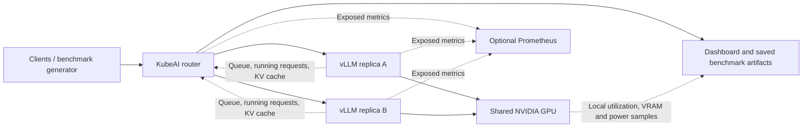
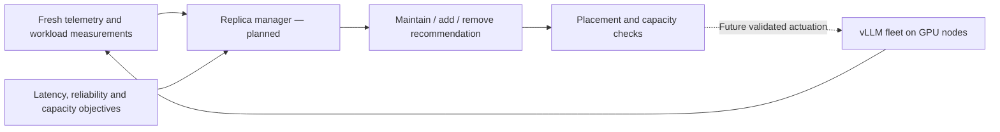

# KubeAI — Project and Scientific Poster Companion

**Adaptive Routing and Replica Management for Efficient LLM Inference**

Authors: Y. Najmi, S. Baba, N. Elmarzouqy, A. Ezzhar  
Project snapshot: 15 November 2026

This document explains the research vision, current implementation, experimental methodology, preliminary results and next steps. It supports the poster and oral presentation; installation commands remain in the [main README](README.md).

## 1. Introduction and motivation

Serving a large language model requires balancing variable user demand against limited GPU resources. Requests differ in input length, output budget and execution time. A deployment must handle these differences while keeping response times acceptable and using resources efficiently.

Adding model replicas or GPUs does not automatically improve throughput. Poor traffic distribution, shared-resource contention, insufficient demand and communication overhead can limit the benefit. Conversely, keeping too many replicas active can consume resources without delivering useful additional work.

KubeAI explores telemetry-informed request routing and, as a longer-term objective, replica management. vLLM executes the language model; KubeAI decides which eligible serving endpoint receives each request and provides tools to evaluate that decision.

## 2. Research question and objectives

**Research question:** Can telemetry-informed routing and replica management improve delivered performance and energy efficiency while respecting latency, reliability and GPU-capacity constraints?

The objectives are to:

- Compare Round robin, Capacity and the proposed KubeAI routing policy under controlled workloads.
- Measure latency, throughput, failures, GPU utilization, VRAM usage and GPU energy per unit of delivered work.
- Identify the operating frontier: how much demand a configuration can serve before response times, queues or failures become unacceptable.
- Determine when to maintain, add, remove or relocate model replicas.
- Build reproducible experiments that explain where a policy helps and where it does not.

The desired long-term outcome is to meet an agreed service target with appropriate GPU resources and energy use. The current prototype evaluates routing; it has not demonstrated automatic scaling or a reduction in the number of required GPUs.

## 3. Main concepts

| Concept | Meaning in this project |
| --- | --- |
| Model | The language model being served, currently `Qwen/Qwen3-0.6B` in the hardware campaign |
| Replica | A separate model-serving instance with its own endpoint and runtime state |
| GPU | The physical device executing inference; multiple replicas can share it |
| Routing | Selecting an existing eligible replica for a request |
| Placement | Selecting a compatible location for a requested allocation |
| Replica management | Deciding when to add, remove or maintain serving instances; planned |
| Benchmark | A controlled workload with saved settings, requests and measurements |

Two replicas on one GPU still share the device's compute resources. A vLLM `gpu_memory_utilization` value of `0.40` is a per-instance VRAM budget, not a guarantee of 40% compute or an enforced GPU-utilization limit.

## 4. Current architecture



The router exposes an OpenAI-compatible inference interface and forwards JSON or streaming responses. Before selection, it checks endpoint health, model compatibility and the requested output budget. The serving backend remains responsible for full prompt/context validation.

The dashboard configures serving URLs, tests connections, starts one benchmark job at a time and displays saved comparisons. Editing an endpoint does not deploy a model or allocate a GPU. A cloud deployment can be connected through its reachable serving URL, but local GPU sampling does not measure remote GPUs.

The current router polls vLLM directly for routing signals. Prometheus is optional observation infrastructure, not a required intermediary in the decision path. Physical-memory routing signals require a separately configured exporter.

### Target architecture: future replica management



The future manager should consider sustained demand, available capacity, startup time and service targets. Cooldown and hysteresis would help avoid repeated scale-up/scale-down oscillation. These are design goals, not implemented control behavior.

## 5. Routing algorithms

All three policies use the same eligibility checks and local reservation mechanism. Failed endpoints temporarily enter cooldown, and stale observations are not treated as fresh measurements.

### Round robin

Rotate across eligible replicas. This is a simple baseline that does not adapt selection to observed queue or cache pressure.

### Capacity

Select the replica minimizing:

```text
(local inflight requests + 1) / configured capacity
```

Configured capacity is a relative serving estimate, not a GPU percentage. This policy responds to local outstanding work but does not use KubeAI's additional telemetry terms.

### KubeAI

Select the replica with the lowest weighted score:

```text
load = max(local inflight, observed waiting + running) / configured capacity
service = configured prefill_seconds + requested max_tokens × token_seconds

score = queue_weight × load × service
      + service_weight × service
      + kv_weight × KV-cache pressure
      + memory_weight × physical-memory pressure
```

The maximum avoids adding local and observed counts that may describe overlapping work. Ties rotate so equal estimates do not starve a replica.

The service coefficients and weights are manually configured research parameters. They are not learned automatically. Physical-memory pressure participates only with a fresh, correctly mapped exporter; that mapping is empty in the current shared-GPU setup.

**GPU utilization, power and energy are currently evaluation measurements, not inputs to the routing score.** Better observed energy efficiency therefore does not establish that the policy explicitly optimizes energy.

Implementation: [kubeai/policy.py](kubeai/policy.py).

## 6. Experimental methodology

The experimental approach combines CPU emulators for functional verification with real vLLM workloads for hardware observations.

1. Keep endpoints, model settings, input pool and benchmark controls fixed within a comparison.
2. Run each routing policy separately with the same controls.
3. Repeat measurements and rotate policy order to reduce systematic order effects.
4. Save exact inputs, request outcomes, configuration snapshots and raw telemetry.
5. Compare performance and energy alongside failures, drops and output truncation.

Two workload modes answer different questions:

- **Closed-loop workers:** each worker sends another request after its previous request finishes. This measures throughput at a selected concurrency; faster policies can complete more requests.
- **Fixed-arrival traces:** requests have predefined arrival times. This supports comparisons under the same external demand, including queue growth and overload behavior.

The results below come from closed-loop experiments. They do not use an identical fixed request count per policy.

### Recorded hardware protocol

| Parameter | Campaign configuration |
| --- | --- |
| Model | `Qwen/Qwen3-0.6B` |
| Physical hardware | One NVIDIA GeForce RTX 4070 Laptop GPU, 8,188 MiB VRAM |
| Serving | Two local vLLM replicas sharing the GPU |
| Working-session serving settings | 2,048-token context; `0.40` VRAM budget per replica |
| Workers | 6 concurrent closed-loop workers |
| Duration | 30-second request-issuance target; final request drain included in measurement |
| Input pool | Same saved varied inputs, seed 42 |
| Requested output budgets | 8, 16, 32 or 64 tokens |
| Warm-up | 2 requests per requested model through the router; excluded from measurement |
| Responses | Streaming enabled |
| Repetitions | 3 runs per policy; 9 runs total |
| GPU measurements | Local utilization, VRAM and board-power samples |
| Provenance limitation | Model revision and serving-image digest unrecorded in all nine manifests |

Policy order was Round robin → Capacity → KubeAI, then Capacity → KubeAI → Round robin, then KubeAI → Round robin → Capacity.

The missing deployment provenance makes this an **exploratory comparison**. Later setup pins cannot retrospectively fill those missing records.

## 7. Measurements and energy calculation

| Metric | Interpretation |
| --- | --- |
| Completed requests/s | Delivered protocol completions divided by measured duration, including drain |
| P50 / P95 latency | Median / 95th percentile of completed-request latency |
| TTFT P95 | 95th percentile of time until the first generated streaming content |
| Failures and drops | Request failures and requests rejected by client dispatch limits |
| Token-limited responses | Completed responses that reached their output-token limit |
| GPU utilization / VRAM | Observed physical-device activity and memory usage |
| Mean GPU power | Estimated average board power over the covered measurement window |
| J/completed request | Estimated gross GPU energy divided by completed requests |
| J/1000 output tokens | Estimated gross GPU energy normalized by recorded output tokens |

Energy is estimated by trapezoidal integration of timestamped board-power samples. Boundary samples cover the measurement window; the calculation does not extrapolate beyond samples. Missing readings or excessive gaps break integration coverage. Full-window normalization requires complete coverage and valid denominators.

Physical GPUs are counted once per UUID even when multiple replicas share them. These are gross GPU-board estimates: they include idle and unrelated GPU activity, exclude CPU/RAM energy and do not assign energy to individual replicas. Complete integration coverage does not imply continuous exact metering.

Dashboard bars show means of per-run values; dots show individual runs. A mean P95 is not a percentile calculated by pooling all requests. Missing values remain unavailable rather than becoming zero.

## 8. Preliminary results

The following values are means across three runs per policy and match the dashboard comparison.

| Policy | Throughput (req/s) | P95 latency (ms) | TTFT P95 (ms) | Mean GPU power (W) | Energy/request (J) | J/1000 output tokens |
| --- | ---: | ---: | ---: | ---: | ---: | ---: |
| Round robin | 18.23 | 814.3 | 42.5 | 71.25 | 3.91 | 158.76 |
| Capacity | 18.26 | 813.6 | 37.7 | 71.18 | 3.90 | 158.29 |
| KubeAI | 24.76 | 738.2 | 40.6 | 72.87 | 2.95 | 120.51 |

Relative to Round robin, using the underlying unrounded means, KubeAI showed:

- **35.8% higher throughput**, approximately **+36%** on the poster.
- **24.6% lower GPU energy per completed request**, approximately **−25%** on the poster.
- **9.3% lower mean per-run P95 latency**.

Capacity had the lowest mean TTFT P95 in this campaign. KubeAI did not improve every measured metric.

Across the nine runs, **5,589 of 5,589 recorded requests completed**, with **zero request failures and zero client drops**. However, **4,960 responses reached their output-token limit**. Protocol completion is not evidence of adequate answer quality.

Mean total energy per run was approximately **2,176 J** for Round robin, **2,167 J** for Capacity and **2,209 J** for KubeAI. KubeAI used about **1.5% more total energy than Round robin**, while delivering more completed requests. The efficiency improvement concerns energy per unit of work; it does not mean lower absolute GPU power or total energy.

### Recommended poster wording

> In exploratory tests, KubeAI achieved approximately 36% higher throughput and 25% lower GPU energy per completed request than Round robin.

Suggested figure caption:

> Qwen3-0.6B · 1 GPU · 2 replicas · 6 workers · 30 s · 3 runs per policy. Exploratory results; model revision and image digest unrecorded.

Use the throughput and energy-per-request graphs together. Label the units, repetition count and reference baseline explicitly. These figures describe the measured configuration, not a promised general improvement.

### Evidence and reproducibility

The [progress report](docs/PROGRESS.md#evidence-locations) links all nine raw summaries and records the source/input hashes. Each run directory contains the manifest, exact inputs, request CSV and raw telemetry. The dashboard comparison group begins `6d82d7fc`.

Raw results are local and ignored by version control by default. Share complete run directories with the report when reproducible evidence is needed; a fresh checkout may not include them.

## 9. Interpretation and limitations

The campaign shows that routing choice was associated with different delivered performance and energy efficiency in this local configuration. It does not isolate which KubeAI score term caused the difference.

The main limits are:

- One model, one physical GPU, one input seed/pool and one concurrency profile.
- Only three repeats per policy; observed variation is not a statistical confidence interval.
- Missing model revision/image digest and no independent attestation of serving flags.
- Shared GPU compute, batching, cache behavior, temperatures and clocks can affect measurements.
- Router warm-up does not guarantee equal warm-up of each physical replica.
- High output truncation and no semantic answer-quality evaluation.
- No controlled one-versus-two-replica result, independent multi-GPU scaling result or measured cloud-cost reduction.
- No automatic replica lifecycle, production service target or overall algorithm ranking score.

## 10. What has been implemented

| Component | Current capability |
| --- | --- |
| Router | OpenAI-compatible JSON/streaming proxy, three policies, eligibility checks and local reservations |
| Telemetry | vLLM queue/running/KV observations; optional physical-memory exporter; local GPU sampling |
| Benchmark engine | Closed-loop workers, saved arrival traces, warm-up, per-request outcomes and manifests |
| Endpoint administration | Configure local/cloud serving URLs, probe model availability and persist valid settings |
| Dashboard | Saved comparison contexts, individual-run inspection and six interactive performance/energy charts |
| Energy analysis | Coverage-aware integration, per-device accounting and normalized metrics |
| Placement | First-fit/best-fit recommendations and optional Kubernetes Pod generation |
| Deployment support | Local Python, Docker/Compose profiles and Kubernetes discovery/templates |

The placement tool does not apply cluster changes or reserve live capacity. A live Kubernetes GPU rollout has not been validated in the recorded work. The existing code verification checkpoint is 128 unit/integration tests plus JavaScript syntax validation; those tests use CPU emulators and mocked NVIDIA readings.

## 11. Next steps and expected deliverables

| Priority | Next step | Expected evidence or deliverable |
| --- | --- | --- |
| 1 | Freeze deployment provenance and benchmark controls | Actual image/model revisions, serving flags, hardware identity, input hashes and direct per-replica warm-up |
| 2 | Define service and output-quality requirements | Agreed P95/TTFT limits, acceptable failure/drop rates and truncation interpretation |
| 3 | Measure the operating frontier | Fixed-arrival steady/burst tests across rates, seeds and output lengths; saturation and energy curves |
| 4 | Calibrate and isolate routing signals | Measured service/capacity coefficients and controlled variants removing individual score terms |
| 5 | Evaluate replica count and physical GPU scaling | Comparable one/two-replica experiments, followed by independent GPU or cloud tests |
| 6 | Validate placement on a real testbed | Fresh inventory and compatible allocation recommendations checked against actual deployments |
| 7 | Introduce replica-management recommendations | Observable maintain/add/remove decisions with cooldown, hysteresis and startup-time handling |
| 8 | Evaluate automatic actuation | Controlled scale-out/scale-in experiments after recommendations are validated |
| 9 | Define scoring if needed | Transparent, versioned criteria based on comparable complete measurements; currently deferred |

Success means a reproducible evaluation and defensible decisions about performance, energy and resource allocation. It does not require every workload to favor KubeAI.

## 12. Documentation and technical map

| Resource | Purpose |
| --- | --- |
| [README.md](README.md) | Single setup and usage entry point: CPU emulators, real vLLM, dashboard, CLI and checks |
| [docs/PROGRESS.md](docs/PROGRESS.md) | Completed milestones, detailed protocol, results, raw evidence and remaining work |
| [docs/DEMO.md](docs/DEMO.md) | Demonstration workflow |
| [deploy/kubernetes/GUIDE.md](deploy/kubernetes/GUIDE.md) | Kubernetes discovery and deployment instructions |
| [docs/TECHNICAL_REPORT.md](docs/TECHNICAL_REPORT.md) | Historical emulator report; separate from the hardware campaign |
| [kubeai/policy.py](kubeai/policy.py) | Routing decisions and reservations |
| [kubeai/experiments.py](kubeai/experiments.py) | Dashboard benchmark-job execution |
| [kubeai/energy.py](kubeai/energy.py) | GPU energy integration |
| [kubeai/results.py](kubeai/results.py) | Saved-run catalog and comparison grouping |
| [kubeai/placement.py](kubeai/placement.py) | Placement recommendations |
| [config/vllm-shared.json](config/vllm-shared.json) | Current shared-GPU router configuration |

The main implementation uses Python 3.11+ with standard-library runtime dependencies. The dashboard uses HTML, CSS and JavaScript. vLLM serves the model; NVIDIA tooling supplies local GPU samples. Prometheus can collect exposed metrics. Grafana is not part of the current dashboard implementation.

## 13. Conclusion

KubeAI provides a working platform for comparing inference routing policies with performance and GPU-energy measurements. Its preliminary shared-GPU campaign observed higher throughput and lower energy per completed request for KubeAI than Round robin, within a limited exploratory setting.

The next research stage is to establish reproducible deployment conditions, measure saturation under controlled external demand and validate the signals behind routing decisions. Those measurements will support future replica-count and placement decisions, followed by carefully evaluated automation.
